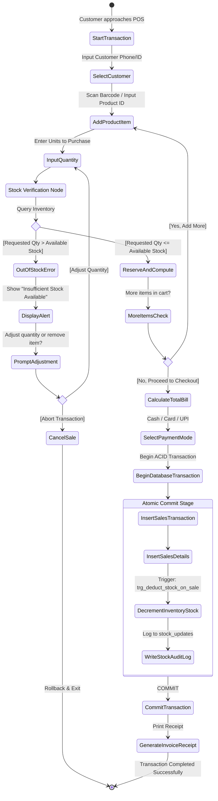

# Activity Diagram Specification: Sales Processing & Stock Control

**Course:** 25ITT33 - Software Engineering (Unit 3: Software Design - Behavioral Models)  
**System:** Retail Store Inventory and Sales Analysis System  

---

## 1. Workflow Narrative

The sales checkout process represents the primary transactional workflow of the retail system:
1. **Initialize Cart:** Cashier initiates transaction and selects or registers customer.
2. **Scan / Enter Products:** Cashier adds product IDs and requested quantities to the cart.
3. **Availability Verification (Decision Node):**
   - For each line item, query `inventory.available_stock`.
   - **Condition [Requested Qty > Available Stock]:** System flags insufficient stock, raises `InsufficientStockException`, presents available balance to cashier, and aborts or requests quantity adjustment without modifying database records.
   - **Condition [Requested Qty <= Available Stock]:** Stock is confirmed available. Proceed to pricing calculation.
4. **Calculate Bill:** System computes line subtotals, applies tax/discounts, and calculates final invoice amount.
5. **Collect Payment:** Cashier records payment mode (Cash, Card, UPI).
6. **Persist Transaction (ACID Commit):**
   - Insert master record into `sales_transactions`.
   - Insert line items into `sales_details`.
   - Database trigger or DAO executes automated stock decrement: `inventory.available_stock = available_stock - quantity_sold`.
   - Insert audit entry into `stock_updates`.
   - Commit atomic transaction.
7. **Generate Receipt:** Print formatted customer receipt and update dashboard.

---

## 2. Activity Diagram (Mermaid)

