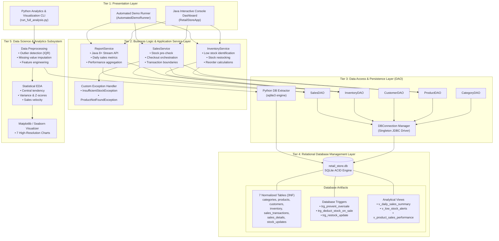

# System Architecture Specification

**Course:** 25ITT33 - Software Engineering (Unit 3: Architectural Design & Styles)  
**System:** Retail Store Inventory and Sales Analysis System  

---

## 1. Architectural Style: 4-Tier Layered Architecture

The Retail Store Inventory and Sales Analysis System is structured using the **Layered Architectural Style** supplemented with the **Data Access Object (DAO)** pattern. This ensures loose coupling, high cohesion, clear separation of concerns, and robust testability.

