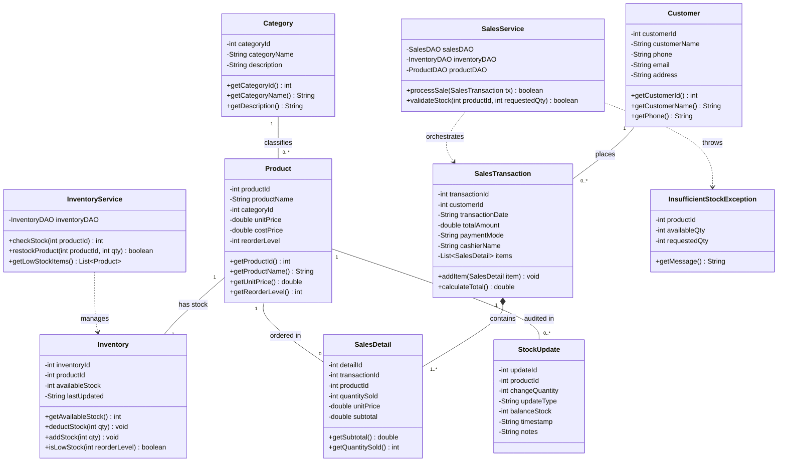

# Class Diagram Specification and Design

**Course:** 25ITT33 - Software Engineering (Unit 2: Class Based Modeling & Unit 3: Software Design)  
**System:** Retail Store Inventory and Sales Analysis System  

---

## 1. Class Structure and Relationships

The system employs an Object-Oriented design adhering to the Model-View-Controller (MVC) and Data Access Object (DAO) architecture:

1. **Domain Entities (Model Layer):**
   - `Category`: Represents product classifications.
   - `Product`: Stores product identity, pricing, and links to categories.
   - `Customer`: Holds customer demographic and contact data.
   - `Inventory`: Encapsulates real-time on-hand stock and reorder thresholds.
   - `SalesTransaction`: Encapsulates master sale invoices (Customer, Date, Payment Mode, Total).
   - `SalesDetail`: Represents individual line items in a transaction (Product, Qty, Unit Price, Subtotal).
   - `StockUpdate`: Records an immutable ledger audit trail for every inventory change.

2. **Data Access Layer (DAO Layer):**
   - `CategoryDAO`, `ProductDAO`, `CustomerDAO`, `InventoryDAO`, `SalesDAO`.
   - Manages CRUD SQL operations using parameterized `PreparedStatement`.

3. **Business Logic & Service Layer:**
   - `SalesService`: Validates stock before checkout, controls ACID boundaries, coordinates line item recording, triggers stock reduction.
   - `InventoryService`: Manages restocking, stock level assertions, discrepancy audits.
   - `ReportService`: Uses Java Stream API to filter and aggregate daily sales and low-stock alerts.

4. **Exception Hierarchy:**
   - `InsufficientStockException`: Custom checked exception thrown when requested quantity > available stock.
   - `ProductNotFoundException`: Thrown when querying a non-existent product ID.

---

## 2. UML Class Diagram (Mermaid)

