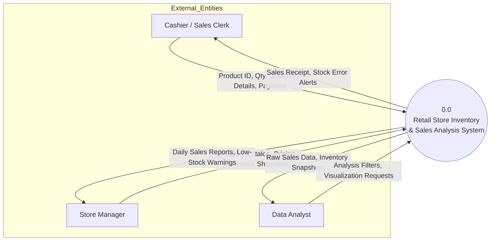

# Data Flow Diagram (DFD) Specification

**Course:** 25ITT33 - Software Engineering (Unit 2: Data Modeling Concepts & Requirements Specification)  
**System:** Retail Store Inventory and Sales Analysis System  

---

## 1. DFD Level 0 (Context-Level Diagram)

The Level 0 DFD portrays the high-level boundary of the Retail Store System, showing external entities and primary information exchanges.



---

## 2. DFD Level 1 (System Decomposition)

The Level 1 DFD decomposes the system into four major functional processes and their associated data stores.

```mermaid
graph TD
    %% External Entities
    Cashier[Cashier]
    Manager[Store Manager]
    Analyst[Data Analyst]

    %% Data Stores
    D1[[(D1) Products & Categories]]
    D2[[(D2) Inventory Store]]
    D3[[(D3) Sales Transactions]]
    D4[[(D4) Stock Updates Audit]]

    %% Processes
    P1((1.0<br>Manage Catalog &<br>Customer Details))
    P2((2.0<br>Verify Stock &<br>Process Sale))
    P3((3.0<br>Update Inventory &<br>Audit Movement))
    P4((4.0<br>Generate Operational<br>Reports))
    P5((5.0<br>Extract Data & Run<br>Python Analytics))

    %% Flows
    Manager -->|Category/Product Data| P1
    P1 -->|Store Product| D1

    Cashier -->|Order: Product ID, Qty| P2
    P2 <-->|Read Stock Level| D2
    P2 -->|Save Order Details| D3
    P2 -->|Trigger Stock Reduction| P3
    P2 -->|Print Bill| Cashier

    P3 -->|Decrement On-Hand Stock| D2
    P3 -->|Write Log Entry| D4

    D2 -->|Stock Quantities| P4
    D3 -->|Daily Revenues| P4
    P4 -->|Operational Reports| Manager

    D1 -->|Catalog Data| P5
    D2 -->|Stock Levels| P5
    D3 -->|Transaction Records| P5
    P5 -->|Charts & Insights| Analyst
```

---

## 3. DFD Level 2 (Sub-Process: 2.0 Process Sale & Stock Verification)

Detailed internal data flow within the sales processing and stock validation engine.

```mermaid
graph TD
    Cashier[Cashier / POS Terminal]

    P2_1((2.1<br>Parse Order<br>Line Items))
    P2_2((2.2<br>Query Current<br>Stock Balance))
    P2_3((2.3<br>Validate Stock<br>Threshold))
    P2_4((2.4<br>Calculate Subtotals<br>& Discounts))
    P2_5((2.5<br>Record Transaction<br>& Trigger Stock Deduction))

    D2[[(D2) Inventory Table]]
    D3[[(D3) Sales Tables]]

    Cashier -->|Product ID, Qty| P2_1
    P2_1 -->|Product ID| P2_2
    P2_2 <-->|Read available_stock| D2
    P2_2 -->|Current Stock, Requested Qty| P2_3

    P2_3 -->|Condition: Qty > Stock| Cashier
    P2_3 -->|Condition: Qty <= Stock (Approved)| P2_4

    P2_4 -->|Order Subtotal, Total Payable| P2_5
    P2_5 -->|Insert Transaction & Details| D3
    P2_5 -->|Issue Final Sales Receipt| Cashier
```
