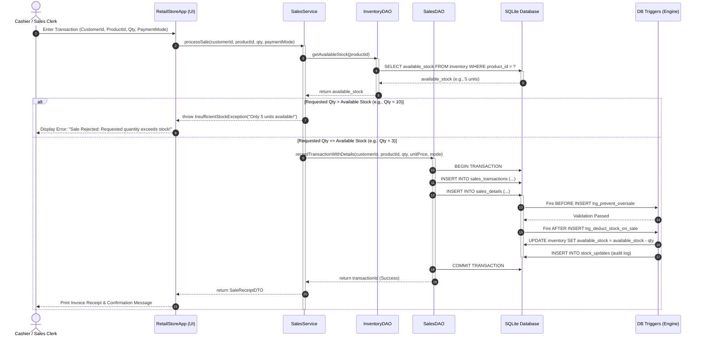

# Sequence Diagram Specification: Sales Processing Interaction

**Course:** 25ITT33 - Software Engineering (Unit 3: Software Design - Interaction Modeling)  
**System:** Retail Store Inventory and Sales Analysis System  

---

## 1. Object Interaction Overview

This sequence diagram illustrates the chronological message exchange between system components during a sales transaction, highlighting:
1. User input capture by `RetailStoreApp` (Presentation Layer).
2. Stock verification request sent to `SalesService` (Business Layer).
3. Querying on-hand stock from `InventoryDAO` and relational database.
4. Exception throwing upon stock shortfall.
5. Transactional persistence across `SalesDAO` and database triggers upon valid checkout.

---

## 2. Sequence Diagram (Mermaid)

