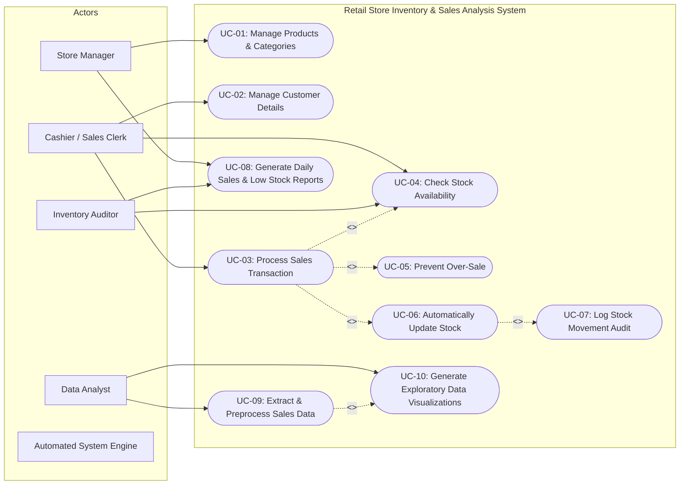

# Use Case Specification and Diagram

**Course:** 25ITT33 - Software Engineering (Unit 2: Requirements & Class Based Modeling)  
**System:** Retail Store Inventory and Sales Analysis System  

---

## 1. Actor Identification and Descriptions

1. **Store Manager (Primary Actor):**
   - Manages product categories and product catalog (Price, Reorder Levels).
   - Authorizes inventory restock shipments.
   - Reviews daily revenue, inventory valuations, and executive audit reports.

2. **Cashier / Sales Clerk (Primary Actor):**
   - Handles customer billing at the point of sale (POS).
   - Queries real-time stock availability.
   - Enters item quantities, selects payment modes, and issues printed customer receipts.

3. **Inventory Auditor (Secondary Actor):**
   - Monitors low-stock alerts and safety stock levels.
   - Adjusts discrepancies discovered during physical stock audits.

4. **Data Analyst / BI Specialist (Secondary Actor):**
   - Connects to the store repository via Python.
   - Preprocesses transactional datasets, calculates sales velocities, and visualizes trends.

---

## 2. Use Case Descriptions

| Use Case ID | Use Case Name | Primary Actor | Description | Preconditions | Postconditions |
| :--- | :--- | :--- | :--- | :--- | :--- |
| **UC-01** | Manage Product Catalog | Store Manager | Create, update, or remove product details and price points. | Manager authenticated. | Product table updated. |
| **UC-02** | Manage Categories | Store Manager | Define product taxonomy (Electronics, Groceries, etc.). | Manager authenticated. | Category registered. |
| **UC-03** | Register Customer | Cashier | Record customer contact details during billing. | Customer provides details. | Customer record saved. |
| **UC-04** | Check Stock Availability | Cashier | Real-time check if required units exist in inventory. | Product exists in system. | Available stock displayed. |
| **UC-05** | Process Sales Checkout | Cashier | Create sales transaction for items and quantity. | Items in cart; Customer selected. | Transaction logged. |
| **UC-06** | Prevent Over-sale (<<extend>>) | System | Reject transaction if requested qty > stock. | Insufficient stock detected. | Transaction aborted; error thrown. |
| **UC-07** | Auto-Deduct Inventory (<<include>>) | System | Reduce physical inventory on successful sale. | Sale transaction committed. | Available stock decremented. |
| **UC-08** | Generate Operational Reports | Store Manager | View daily sales summary, low stock items. | Database accessible. | Formatted report generated. |
| **UC-09** | Run Python Data Science Pipeline | Data Analyst | Preprocess sales data and generate visual charts. | Python environment ready. | 7 charts and metrics outputted. |

---

## 3. Use Case Diagram (Mermaid)

