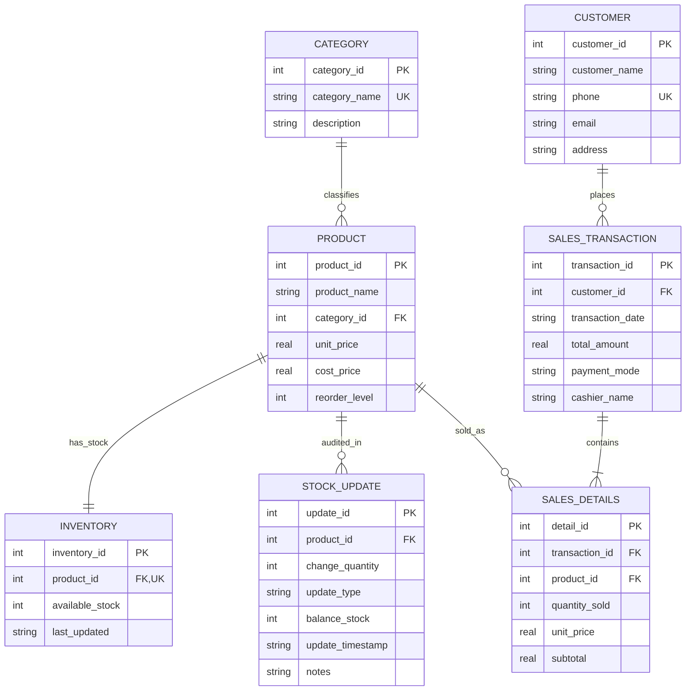

# Entity-Relationship (E-R) Diagram Specification

**Course:** 25ITT31 - Database Management Systems (Unit 1: Database Systems and Design - E-R Model)  
**System:** Retail Store Inventory and Sales Analysis System  

---

## 1. Entity Sets, Attributes, and Classifications

The conceptual schema comprises seven distinct entities designed to capture all facets of retail inventory and point-of-sale operations:

1. **CATEGORY Entity:**
   - `category_id` (Primary Key, Integer, Auto-increment)
   - `category_name` (Text, Unique, Mandatory)
   - `description` (Text, Optional)

2. **PRODUCT Entity:**
   - `product_id` (Primary Key, Integer, Auto-increment)
   - `product_name` (Text, Mandatory)
   - `category_id` (Foreign Key referencing CATEGORY, Mandatory)
   - `unit_price` (Decimal/Real, Mandatory, Check: unit_price > 0)
   - `cost_price` (Decimal/Real, Mandatory, Check: cost_price > 0)
   - `reorder_level` (Integer, Mandatory, Check: reorder_level >= 0)

3. **CUSTOMER Entity:**
   - `customer_id` (Primary Key, Integer, Auto-increment)
   - `customer_name` (Text, Mandatory)
   - `phone` (Text, Unique, Mandatory)
   - `email` (Text, Optional)
   - `address` (Text, Optional)

4. **INVENTORY Entity (1:1 Extension of PRODUCT):**
   - `inventory_id` (Primary Key, Integer, Auto-increment)
   - `product_id` (Foreign Key referencing PRODUCT, Unique, Mandatory)
   - `available_stock` (Integer, Mandatory, Check: available_stock >= 0)
   - `last_updated` (Timestamp / Text, Default CURRENT_TIMESTAMP)

5. **SALES_TRANSACTION Entity (Invoice Master):**
   - `transaction_id` (Primary Key, Integer, Auto-increment)
   - `customer_id` (Foreign Key referencing CUSTOMER, Mandatory)
   - `transaction_date` (Timestamp / Text, Mandatory)
   - `total_amount` (Decimal/Real, Mandatory, Check: total_amount >= 0)
   - `payment_mode` (Text, Mandatory, Check: 'Cash', 'Credit Card', 'Debit Card', 'UPI')
   - `cashier_name` (Text, Mandatory)

6. **SALES_DETAILS Entity (Associative / Weak Entity representing Transaction Line Items):**
   - `detail_id` (Primary Key, Integer, Auto-increment)
   - `transaction_id` (Foreign Key referencing SALES_TRANSACTION, Mandatory)
   - `product_id` (Foreign Key referencing PRODUCT, Mandatory)
   - `quantity_sold` (Integer, Mandatory, Check: quantity_sold > 0)
   - `unit_price` (Decimal/Real, Mandatory, Check: unit_price > 0)
   - `subtotal` (Decimal/Real, Mandatory, Check: subtotal >= 0)

7. **STOCK_UPDATE Entity (Immutable Audit Ledger):**
   - `update_id` (Primary Key, Integer, Auto-increment)
   - `product_id` (Foreign Key referencing PRODUCT, Mandatory)
   - `change_quantity` (Integer, Mandatory, can be positive for restock or negative for sale)
   - `update_type` (Text, Mandatory, Check: 'SALE', 'RESTOCK', 'ADJUSTMENT', 'RETURN')
   - `balance_stock` (Integer, Mandatory, Check: balance_stock >= 0)
   - `update_timestamp` (Timestamp / Text, Default CURRENT_TIMESTAMP)
   - `notes` (Text, Optional)

---

## 2. Relationships and Mapping Cardinalities

1. **CLASSIFIES (Category to Product):**
   - Cardinality: **$1 : N$ (One-to-Many)**.
   - A single Category classifies one or many Products.
   - Each Product belongs to exactly one Category.
   - Total participation on Product side.

2. **HAS_STOCK (Product to Inventory):**
   - Cardinality: **$1 : 1$ (One-to-One)**.
   - Every Product has exactly one Inventory tracking entry.
   - Total participation on both sides.

3. **PLACES (Customer to Sales_Transaction):**
   - Cardinality: **$1 : N$ (One-to-Many)**.
   - A Customer may place zero, one, or many Sales Transactions.
   - Each Sales Transaction is attributed to exactly one Customer.

4. **CONTAINS_ITEMS (Sales_Transaction to Sales_Details):**
   - Cardinality: **$1 : N$ (One-to-Many)**.
   - A Sales Transaction consists of one or many Sales Detail line items.
   - Total participation on Sales_Details.

5. **SOLD_AS (Product to Sales_Details):**
   - Cardinality: **$1 : N$ (One-to-Many)**.
   - A Product can appear in zero, one, or multiple Sales Details across different orders.

6. **AUDITED_IN (Product to Stock_Update):**
   - Cardinality: **$1 : N$ (One-to-Many)**.
   - A Product has an ongoing ledger of Stock Updates reflecting every sale or restock.

---

## 3. Entity-Relationship Diagram (Mermaid)

